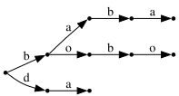

# Задачи за списъци - бонус

[код от упражнението](bonus-lists.rkt)

## Множества, пермутации, комбинации

### Зад.1.
Да се напише функция `(subsets lst)`, която връща списък от всички подмножества на даден списък. Няма нужда да проверявате дали в списъка има повтарящи се елементи, би било добре решението Ви да не разчита на това. Поредността на върнатите множества няма значение, лексикографска наредба би била бонус.
```racket
(subsets '(1 2 3)) -> '(() (1) (2) (3) (1 2) (1 3) (2 3) (1 2 3))
```

### Зад.2.
Да се напише функция `(rotations lst)`, която връща всички ротации на даден списък.
```racket
(rotations '(1 2 3 4)) -> '((1 2 3 4) (2 3 4 1) (3 4 1 2) (4 1 2 3))
```

### Зад.3.
Да се напише функция `(permutations lst)`, която връща всички пермутации на даден списък. Поредността на върнатите пермутации няма значение, лексикографска наредба би била бонус.
```racket
(permutations '(1 2 3)) -> '((1 2 3) (1 3 2) (2 1 3) (2 3 1) (3 1 2) (3 2 1))
```

### Зад.4.
Да се напише функция `(combinations k lst)`, която връща всички `k`-елементни комбинации на даден списък. Поредността на върнатите комбинации няма значение, лексикографска наредба би била бонус.
```racket
(combinations 2 '(1 2 3 4 5)) -> '((1 2) (1 3) (1 4) (1 5) (2 3) (2 4) (2 5) (3 4) (3 5) (4 5))
```

## Автомати и низове

Scheme поддържа "символни низове" (strings) - обекти, чиито елементи са графеми (characters / graphemes).
Синтаксисът за конструиране на графема е с диез и обратна наклонена черта: `#\f`, а този
за конструиране на низ е с двойни кавички: `"foo bar"`.

Стандартната библиотека разполага със следните функции за низове, които ще използваме често:
- `(make-string n c)` - Създава низ със дължина `n`, който се състои от повторения на графемата `c`
- `(string-length str)` - Връща дължината на подадения низ
- `(string-ref str k)` - Връща символът на позиция `k` в дадения низ
- `(string-append str ...)` - Връща нов низ, който се получава при долепяне на подадените низове
- `(substring str start [end])` - Връща поднизът от индекс `start` до индекс `end` (ако е подаден, иначе до края)

Ще представяме детерминиран краен автомат като списък от три елемента: таблица на преходите, начално състояние и крайно състояние. Таблицата на преходите ще представлява асоциативен списък от наредени двойки (състояние,символ) към състояние. Например, автоматът разпознаващ езика `(ba)*`, може да изглежда така:
```racket
(define a1
  (list (list
         (cons (cons 'A #\b) 'B)
         (cons (cons 'B #\a) 'A))
        'A
        (list 'A)))
```
Състоянията в този пример са атоми, но могат да са от какъвто тип е удобно, стига да е сравним с `equal?`.

### Зад.5.
Да се напише функция `(apply-delta delta state symb)`, която по дадени таблица на преходи, състояние и символ, връща следващото състояние ако съществува, и `#f` иначе.
```racket
(apply-delta (head a1) 'B #\a) -> 'A
(apply-delta (head a1) 'B #\m) -> #f
```

### Зад.6.
Да се напиша функция `(accepts? automaton word)`, която проверява дали дадения автомат `automaton` разпознава символния низ `word`.
```racket
(accepts? a1 "baba") -> #t
(accepts? a1 "bad") -> #f
```

## Префиксни дървета
Ще представяме структурата префиксно дърво (trie) като асоциативен списък от букви (графеми) към други префиксни дървета. Казваме, че една дума е част от езика на едно префиксно дърво, ако съществува път от корена до листо на дървото, минаващ по буквите на думата. Естествено, празното дърво ще представяме с празния списък.

Ето пример за префиксно дърво, разпознаващо думите `"baba"`, `"bobo"` и `"da"`:
```racket
(define t1
  (list
   (cons #\b (list
              (cons #\a (list (cons #\b (list (cons #\a '())))))
              (cons #\o (list (cons #\b (list (cons #\o '())))))))
   (cons #\d (list (cons #\a '())))))
```


### Зад.7.
Да се напише функция `(trie-accepts? trie word)`, която проверява дали дадена дума е в езика на дадено префиксно дърво.
```racket
(trie-accepts? t1 "baba") -> #t
(trie-accepts? t1 "bad") -> #f
```

### Зад.8.
Да се напише функция `(trie-add word trie)`, която добавя дадена дума към префиксно дърво.

### Зад.9.
Да се напише функция `(trie-words trie)`, която връща всички низове в езика на дадено префиксно дърво, без значение редът им.
```racket
(trie-words t1) -> '("baba","bobo","da")
(trie-words (trie-add "aaa" t1)) -> '("baba","bobo","da","aaa")
```

### Зад.10.
Променете имплементацията си на `trie-add` така, че да поддържа лексикографска наредба на символите (ключовете) във всеки асоциативен списък.
Какъв тогава е ефектът от следната функция, приемаща списък от низове:
```racket
(define (what? words) (trie-words (foldr trie-add '() words)))
```
