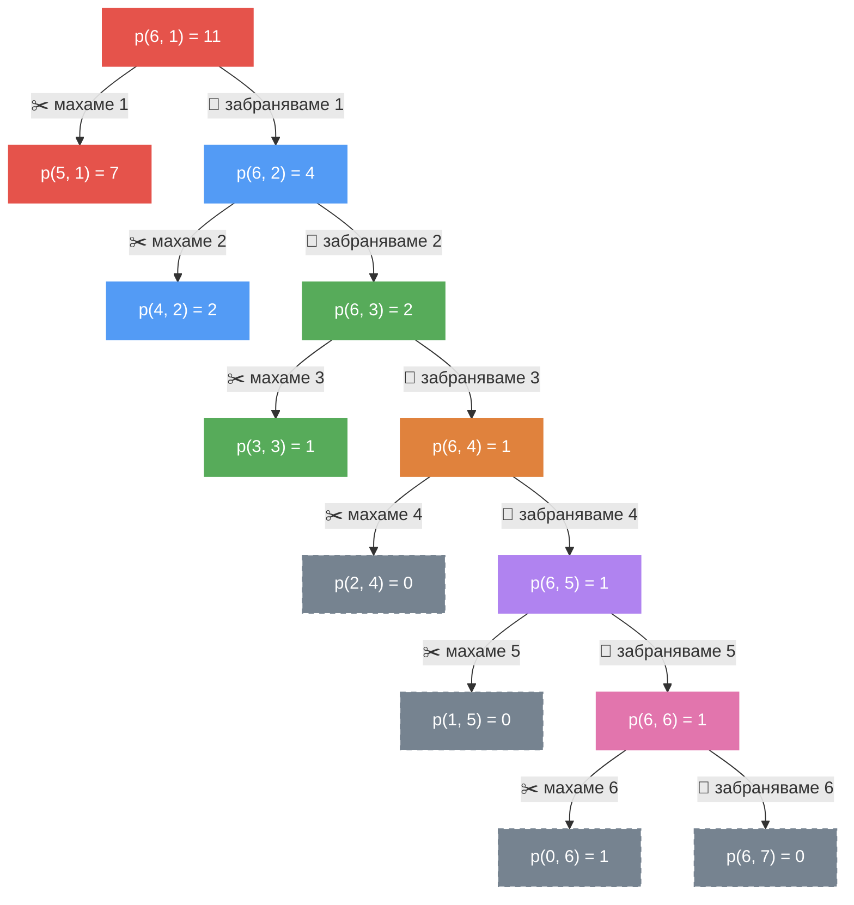

# Рекурсия

### Задача 1
Напишете процедура, която пресмята `n`-тото число на Фибоначи (0, 1, 1, 2, 3, 5, 8, 13, 21, ...)
 - с дървовиден рекурсивен процес
 - с линеен итеративен процес

```racket
(= (fib-recursive 12) 144)

(= (fib-iterative 12) 144)
```

### Задача 2 :woman_singer:
Поп-фолк изпълнителката Галена току-що е публикувала най-новата си песен "От тебе няма по-по-по...", посветена на Функционалното програмиране. Тя забелязва странна тенденция в броя на гледанията на клипа на новата си песен - всяка вечер те се увеличават с точно `new-views`, което я кара да си ляга щастлива, но при всяко нейно събуждане остава много разочарована, защото всяка сутрин броят на гледанията е намалял с точно `lost-views`... Вашата задача е да помогнете на Галена да разбере за колко дни нейното видео ще събере `desired-views` на брой гледания въпреки странната тенденция.

```racket
(= (help-galena 100000 10000 910000) 10)
```

### Задача 3 :chart_with_upwards_trend:
След като е прекарал цяла нощ в Plaza, Гошо се събужда със страшен махмурлук и закъсняващ преди контролното по Логическо програмиране. Добре, че е започнал работа като програмист, та си е позволил лукса да живее на квартира на 5 минути от ФМИ... Той бързо стига до факултета, но за негово нещастие асансьорът не работи и той трябва да се качва пеша до 5-я етаж. Той трябва да изкачи `n` на брой стълби, като с всяка стъпка той може да изкачи 1 или 2 стъпала. Напишете процедура `road-to-logprog`, която пресмята по колко различни начина Гошо може да изкачи стълбите.

```racket
(= (road-to-logprog 4) 5)
(= (road-to-logprog 5) 8)
(= (road-to-logprog 10) 89)
```

### Задача 4
Реализирайте линейно итеративен процес, който да обръща неотрицателно число.

```racket
(= (rev 0) 0)
(= (rev 123) 321)
(= (rev 987654321) 123456789)
(= (rev 12000) 21)
```

### Задача 5
Напишете процедура `my-recursive-pow`, която пресмята на колко е равно `x`, повдигнато на степен `n`.

```racket
(= (my-recursive-pow 2 5) 32)
(= (my-recursive-pow 15 3) 3375)
```

### Задача 6
Напишете процедура `prime?`, която проверява дали дадено естествено число е просто.

```racket
(equal? (prime? 1) #f)
(equal? (prime? 2) #t)
(equal? (prime? 3) #t)
(equal? (prime? 6) #f)
(equal? (prime? 42) #f)
(equal? (prime? 61) #t)
```

### Задача 7
Напишете процедура `increasing-digits?`, която проверява дали цифрите на дадено естествено число са подредени в ненамаляващ ред.

```racket
(equal? (increasing-digits? 1244) #t)
(equal? (increasing-digits? 12443) #f)
```

### Задача 8
Напишете процедура `palindromes-between`, която намира броя числа палиндроми в интервала `[a, b]`.

```racket
(= (palindromes-between 1 101) 19)
(= (palindromes-between 1 100) 18)
(= (palindromes-between 100 1) 18)
```

### Задача 9
Напишете процедура `sum-first-special-numbers`, която намира сумата на първите `n` прости числа, съдържащи цифрата `d`.

```racket
(= (sum-first-special-numbers 5 2) 392)
(= (sum-first-special-numbers 5 3) 107)
(= (sum-first-special-numbers 10 3) 462)
```

### Задача 10
Едно число `n` се нарича автоморфно, ако числото `n^2` "завършва" с цифрите на `n`. Напишете предикат `automorphic?`, който проверява дали едно число е автоморфно.

```racket
(equal? (automorphic? 3) #f)
(equal? (automorphic? 10) #f)
(equal? (automorphic? 5) #t)
(equal? (automorphic? 25) #t)
(equal? (automorphic? 76) #t) 
(equal? (automorphic? 890625) #t) 
(equal? (automorphic? 625) #t) 
(equal? (automorphic? 36) #f)
(equal? (automorphic? 11) #f)
```

### Задача 11
Напишете процедура `subnumber?`, която проверява дали дадено естествено число `x` е "подчисло" на `y`.

```racket
(equal? (subnumber? 123 5123783) #t)
(equal? (subnumber? 0 0) #t)
(equal? (subnumber? 10 101) #t)
(equal? (subnumber? 101 101) #t)
(equal? (subnumber? 10 0) #f)
(equal? (subnumber? 1253 5123783) #f)
(equal? (subnumber? 12 0) #f)
```

### Задача 12
Цифров корен на дадено цяло положително число `n` e едноцифрено число, което се пресмята по следния начин: събираме цифрите на `n`. Ако сумата е едноцифрено число, то това е цифровият корен. Ако сумата е число с повече от една цифра, процедурата се повтаря, докато се получи едноцифрено число (например `493193 -> 29 -> 11 -> 2`).

Напишете процедура `digital-root`, която пресмята цифровия корен на дадено число `n`.

```racket
(= (digital-root 5) 5)
(= (digital-root 39) 3)
(= (digital-root 493193) 2)
```

### Задача 13
Напишете процедура `remove-first-occurrence`, която премахва първото срещане на цифра `d` в число `n`, броейки отдясно наляво (от цифрата на единиците).

```racket
(= (remove-first-occurrence 15365 5) 1536)
(= (remove-first-occurrence 15360 0) 1536)
(= (remove-first-occurrence 15300 0) 1530)
(= (remove-first-occurrence 15365 1) 5365)
(= (remove-first-occurrence 35365 3) 3565)
(= (remove-first-occurrence 1212 1) 122)
(= (remove-first-occurrence 1212 2) 121)
(= (remove-first-occurrence (remove-first-occurrence 1212 1) 1) 22)
```

### Задача 14
Напишете процедура `sort-n`, която сортира цифрите на естествено число в намаляващ ред.

```racket
(= (sort-n 1714) 7411)
(= (sort-n 123450) 543210)
(= (sort-n 123405) 543210)
(= (sort-n 123045) 543210)
(= (sort-n 120345) 543210)
(= (sort-n 102345) 543210)
(= (sort-n 8910) 9810)
(= (sort-n 321) 321)
(= (sort-n 29210) 92210)
(= (sort-n 1230) 3210)
(= (sort-n 55345) 55543)
(= (sort-n 14752) 75421)
(= (sort-n 329450) 954320)
(= (sort-n 9125) 9521)
```

### Задача 15
Напишете процедура `partition-function`, която намира броя начини за представяне на положително цяло число `n` като сума на положителни цели числа. Събираемите могат да се повтарят, а редът им няма значение (`1 + 3` и `3 + 1` се броят за един начин).

> Например `4` може да се представи по 5 начина: `4`, `3 + 1`, `2 + 2`, `2 + 1 + 1`, `1 + 1 + 1 + 1`.

```racket
(= (partition-function 4) 5)
(= (partition-function 5) 7)
(= (partition-function 10) 42)
```

<details>
<summary><b>💡 Покажи подсказка</b></summary>

<br>

Разпишете всички начини за `6` и всички начини за `5` и ги сравнете.

Начините за `6`, в които участва поне една единица, са точно 7. Ако махнем по една единица от всеки от тях, получаваме всички начини за `5`:

| Начини за `6` | махаме една ${\color{#E5534B}\mathbf{1}}$ | Начини за `5` |
|---|---|---|
| ${\color{#B083F0}\mathbf{5}} + {\color{#E5534B}\mathbf{1}}$ | → | ${\color{#B083F0}\mathbf{5}}$ |
| ${\color{#E0823D}\mathbf{4}} + {\color{#E5534B}\mathbf{1}} + {\color{#E5534B}\mathbf{1}}$ | → | ${\color{#E0823D}\mathbf{4}} + {\color{#E5534B}\mathbf{1}}$ |
| ${\color{#57AB5A}\mathbf{3}} + {\color{#539BF5}\mathbf{2}} + {\color{#E5534B}\mathbf{1}}$ | → | ${\color{#57AB5A}\mathbf{3}} + {\color{#539BF5}\mathbf{2}}$ |
| ${\color{#57AB5A}\mathbf{3}} + {\color{#E5534B}\mathbf{1}} + {\color{#E5534B}\mathbf{1}} + {\color{#E5534B}\mathbf{1}}$ | → | ${\color{#57AB5A}\mathbf{3}} + {\color{#E5534B}\mathbf{1}} + {\color{#E5534B}\mathbf{1}}$ |
| ${\color{#539BF5}\mathbf{2}} + {\color{#539BF5}\mathbf{2}} + {\color{#E5534B}\mathbf{1}} + {\color{#E5534B}\mathbf{1}}$ | → | ${\color{#539BF5}\mathbf{2}} + {\color{#539BF5}\mathbf{2}} + {\color{#E5534B}\mathbf{1}}$ |
| ${\color{#539BF5}\mathbf{2}} + {\color{#E5534B}\mathbf{1}} + {\color{#E5534B}\mathbf{1}} + {\color{#E5534B}\mathbf{1}} + {\color{#E5534B}\mathbf{1}}$ | → | ${\color{#539BF5}\mathbf{2}} + {\color{#E5534B}\mathbf{1}} + {\color{#E5534B}\mathbf{1}} + {\color{#E5534B}\mathbf{1}}$ |
| ${\color{#E5534B}\mathbf{1}} + {\color{#E5534B}\mathbf{1}} + {\color{#E5534B}\mathbf{1}} + {\color{#E5534B}\mathbf{1}} + {\color{#E5534B}\mathbf{1}} + {\color{#E5534B}\mathbf{1}}$ | → | ${\color{#E5534B}\mathbf{1}} + {\color{#E5534B}\mathbf{1}} + {\color{#E5534B}\mathbf{1}} + {\color{#E5534B}\mathbf{1}} + {\color{#E5534B}\mathbf{1}}$ |

Остават начините за `6` без нито една единица: ${\color{#E275AD}\mathbf{6}}$, ${\color{#E0823D}\mathbf{4}} + {\color{#539BF5}\mathbf{2}}$, ${\color{#57AB5A}\mathbf{3}} + {\color{#57AB5A}\mathbf{3}}$, ${\color{#539BF5}\mathbf{2}} + {\color{#539BF5}\mathbf{2}} + {\color{#539BF5}\mathbf{2}}$. Общо `7 + 4 = 11`.

Как да преброим тези 4 начина? По същия начин, но вече с двойката. Начините за `6` без единици, в които участва поне една двойка, са 2. Ако махнем по една двойка от всеки от тях, получаваме всички начини за `4` без единици:

| Начини за `6` без единици | махаме една ${\color{#539BF5}\mathbf{2}}$ | Начини за `4` без единици |
|---|---|---|
| ${\color{#E0823D}\mathbf{4}} + {\color{#539BF5}\mathbf{2}}$ | → | ${\color{#E0823D}\mathbf{4}}$ |
| ${\color{#539BF5}\mathbf{2}} + {\color{#539BF5}\mathbf{2}} + {\color{#539BF5}\mathbf{2}}$ | → | ${\color{#539BF5}\mathbf{2}} + {\color{#539BF5}\mathbf{2}}$ |

Остават начините за `6` без единици и без двойки: ${\color{#E275AD}\mathbf{6}}$, ${\color{#57AB5A}\mathbf{3}} + {\color{#57AB5A}\mathbf{3}}$. Тях можем да преброим по същия начин, но вече с тройката, и т.н.

Тоест на всяка стъпка или **махаме** едно най-малко допустимо събираемо (и числото намалява), или **забраняваме** това събираемо (и най-малкото допустимо събираемо се увеличава). Каква допълнителна информация трябва да пази процедурата ви освен самото число?

</details>

<details>
<summary><b>✅ Покажи решение</b></summary>

<br>

#### Идея

Освен самото число ще пазим и **най-малкото допустимо събираемо**. Нека

> $p(n, k)$ е броят начини да представим `n` като сума, в която **всяко събираемо е поне `k`**.

Например $p(6, 3) = 2$ (това са ${\color{#E275AD}\mathbf{6}}$ и ${\color{#57AB5A}\mathbf{3}} + {\color{#57AB5A}\mathbf{3}}$), а $p(6, 2) = 4$ (${\color{#E275AD}\mathbf{6}}$, ${\color{#E0823D}\mathbf{4}} + {\color{#539BF5}\mathbf{2}}$, ${\color{#57AB5A}\mathbf{3}} + {\color{#57AB5A}\mathbf{3}}$ и ${\color{#539BF5}\mathbf{2}} + {\color{#539BF5}\mathbf{2}} + {\color{#539BF5}\mathbf{2}}$).

Отговорът на задачата е $p(n, 1)$ — всяко събираемо е поне `1`, т.е. нямаме никакво ограничение.

В примерите по-долу всяко събираемо има свой цвят: ${\color{#E5534B}\mathbf{1}}$, ${\color{#539BF5}\mathbf{2}}$, ${\color{#57AB5A}\mathbf{3}}$, ${\color{#E0823D}\mathbf{4}}$, ${\color{#B083F0}\mathbf{5}}$, ${\color{#E275AD}\mathbf{6}}$.

#### Формулата

Разделяме всички начини за $p(n, k)$ на две групи според това дали `k` участва в тях:

- ✂️ **`k` участва поне веднъж.** Ако махнем едно `k`, получаваме начин за `n - k`, в който всички събираеми пак са поне `k`. И обратно — ако към всеки начин за `n - k` добавим едно `k`, получаваме начин за `n`. Значи начините в тази група са точно $p(n - k, k)$.
- 🚫 **`k` не участва.** Тогава всяко събираемо е поне `k + 1`, т.е. начините в тази група са точно $p(n, k + 1)$.

Всеки начин попада в точно една от двете групи, затова:

$$p(n, k) = \underset{\text{махаме едно } k}{\underbrace{p(n - k, k)}} + \underset{\text{забраняваме } k}{\underbrace{p(n, k + 1)}}$$

Дъна на рекурсията:

- $p(0, k) = 1$ — махнали сме всички събираеми, т.е. сме стигнали до **един** валиден начин.
- $p(n, k) = 0$, ако $k > n$ — дори най-малкото допустимо събираемо е по-голямо от числото, така че няма как да го представим.

> ⚠️ Редът на проверките има значение: първо проверяваме дали $n = 0$. Например $p(0, 1)$ трябва да е `1` (стигнали сме до начин), въпреки че $1 > 0$.

#### Пример: $p(6, 1)$

Започваме с всички 11 начина за `6` и на всяка стъпка разделяме останалите начини на две групи.

**Стъпка 1** — най-малкото допустимо събираемо е ${\color{#E5534B}\mathbf{1}}$:

$$p(6, {\color{#E5534B}\mathbf{1}}) = p(5, {\color{#E5534B}\mathbf{1}}) + p(6, {\color{#539BF5}\mathbf{2}})$$

| ✂️ С поне едно ${\color{#E5534B}\mathbf{1}}$ | → махаме едно ${\color{#E5534B}\mathbf{1}}$ | 🚫 Без ${\color{#E5534B}\mathbf{1}}$ |
|---|---|---|
| ${\color{#B083F0}\mathbf{5}} + {\color{#E5534B}\mathbf{1}}$ | ${\color{#B083F0}\mathbf{5}}$ | ${\color{#E275AD}\mathbf{6}}$ |
| ${\color{#E0823D}\mathbf{4}} + {\color{#E5534B}\mathbf{1}} + {\color{#E5534B}\mathbf{1}}$ | ${\color{#E0823D}\mathbf{4}} + {\color{#E5534B}\mathbf{1}}$ | ${\color{#E0823D}\mathbf{4}} + {\color{#539BF5}\mathbf{2}}$ |
| ${\color{#57AB5A}\mathbf{3}} + {\color{#539BF5}\mathbf{2}} + {\color{#E5534B}\mathbf{1}}$ | ${\color{#57AB5A}\mathbf{3}} + {\color{#539BF5}\mathbf{2}}$ | ${\color{#57AB5A}\mathbf{3}} + {\color{#57AB5A}\mathbf{3}}$ |
| ${\color{#57AB5A}\mathbf{3}} + {\color{#E5534B}\mathbf{1}} + {\color{#E5534B}\mathbf{1}} + {\color{#E5534B}\mathbf{1}}$ | ${\color{#57AB5A}\mathbf{3}} + {\color{#E5534B}\mathbf{1}} + {\color{#E5534B}\mathbf{1}}$ | ${\color{#539BF5}\mathbf{2}} + {\color{#539BF5}\mathbf{2}} + {\color{#539BF5}\mathbf{2}}$ |
| ${\color{#539BF5}\mathbf{2}} + {\color{#539BF5}\mathbf{2}} + {\color{#E5534B}\mathbf{1}} + {\color{#E5534B}\mathbf{1}}$ | ${\color{#539BF5}\mathbf{2}} + {\color{#539BF5}\mathbf{2}} + {\color{#E5534B}\mathbf{1}}$ |  |
| ${\color{#539BF5}\mathbf{2}} + {\color{#E5534B}\mathbf{1}} + {\color{#E5534B}\mathbf{1}} + {\color{#E5534B}\mathbf{1}} + {\color{#E5534B}\mathbf{1}}$ | ${\color{#539BF5}\mathbf{2}} + {\color{#E5534B}\mathbf{1}} + {\color{#E5534B}\mathbf{1}} + {\color{#E5534B}\mathbf{1}}$ |  |
| ${\color{#E5534B}\mathbf{1}} + {\color{#E5534B}\mathbf{1}} + {\color{#E5534B}\mathbf{1}} + {\color{#E5534B}\mathbf{1}} + {\color{#E5534B}\mathbf{1}} + {\color{#E5534B}\mathbf{1}}$ | ${\color{#E5534B}\mathbf{1}} + {\color{#E5534B}\mathbf{1}} + {\color{#E5534B}\mathbf{1}} + {\color{#E5534B}\mathbf{1}} + {\color{#E5534B}\mathbf{1}}$ |  |
| | **$p(5, {\color{#E5534B}\mathbf{1}}) = 7$** | **$p(6, {\color{#539BF5}\mathbf{2}}) = 4$** |

Средната колона е точно всички начини за `5` — затова групата е $p(5, {\color{#E5534B}\mathbf{1}})$. Продължаваме с дясната колона.

**Стъпка 2** — най-малкото допустимо събираемо е ${\color{#539BF5}\mathbf{2}}$:

$$p(6, {\color{#539BF5}\mathbf{2}}) = p(4, {\color{#539BF5}\mathbf{2}}) + p(6, {\color{#57AB5A}\mathbf{3}})$$

| ✂️ С поне едно ${\color{#539BF5}\mathbf{2}}$ | → махаме едно ${\color{#539BF5}\mathbf{2}}$ | 🚫 Без ${\color{#539BF5}\mathbf{2}}$ |
|---|---|---|
| ${\color{#E0823D}\mathbf{4}} + {\color{#539BF5}\mathbf{2}}$ | ${\color{#E0823D}\mathbf{4}}$ | ${\color{#E275AD}\mathbf{6}}$ |
| ${\color{#539BF5}\mathbf{2}} + {\color{#539BF5}\mathbf{2}} + {\color{#539BF5}\mathbf{2}}$ | ${\color{#539BF5}\mathbf{2}} + {\color{#539BF5}\mathbf{2}}$ | ${\color{#57AB5A}\mathbf{3}} + {\color{#57AB5A}\mathbf{3}}$ |
| | **$p(4, {\color{#539BF5}\mathbf{2}}) = 2$** | **$p(6, {\color{#57AB5A}\mathbf{3}}) = 2$** |

**Стъпка 3** — най-малкото допустимо събираемо е ${\color{#57AB5A}\mathbf{3}}$:

$$p(6, {\color{#57AB5A}\mathbf{3}}) = p(3, {\color{#57AB5A}\mathbf{3}}) + p(6, {\color{#E0823D}\mathbf{4}})$$

| ✂️ С поне едно ${\color{#57AB5A}\mathbf{3}}$ | → махаме едно ${\color{#57AB5A}\mathbf{3}}$ | 🚫 Без ${\color{#57AB5A}\mathbf{3}}$ |
|---|---|---|
| ${\color{#57AB5A}\mathbf{3}} + {\color{#57AB5A}\mathbf{3}}$ | ${\color{#57AB5A}\mathbf{3}}$ | ${\color{#E275AD}\mathbf{6}}$ |
| | **$p(3, {\color{#57AB5A}\mathbf{3}}) = 1$** | **$p(6, {\color{#E0823D}\mathbf{4}}) = 1$** |

**Стъпка 4** — най-малкото допустимо събираемо е ${\color{#E0823D}\mathbf{4}}$:

$$p(6, {\color{#E0823D}\mathbf{4}}) = p(2, {\color{#E0823D}\mathbf{4}}) + p(6, {\color{#B083F0}\mathbf{5}})$$

| ✂️ С поне едно ${\color{#E0823D}\mathbf{4}}$ | → махаме едно ${\color{#E0823D}\mathbf{4}}$ | 🚫 Без ${\color{#E0823D}\mathbf{4}}$ |
|---|---|---|
| — | — | ${\color{#E275AD}\mathbf{6}}$ |
| | **$p(2, {\color{#E0823D}\mathbf{4}}) = 0 \quad (4 > 2)$** | **$p(6, {\color{#B083F0}\mathbf{5}}) = 1$** |

**Стъпка 5** — най-малкото допустимо събираемо е ${\color{#B083F0}\mathbf{5}}$:

$$p(6, {\color{#B083F0}\mathbf{5}}) = p(1, {\color{#B083F0}\mathbf{5}}) + p(6, {\color{#E275AD}\mathbf{6}})$$

| ✂️ С поне едно ${\color{#B083F0}\mathbf{5}}$ | → махаме едно ${\color{#B083F0}\mathbf{5}}$ | 🚫 Без ${\color{#B083F0}\mathbf{5}}$ |
|---|---|---|
| — | — | ${\color{#E275AD}\mathbf{6}}$ |
| | **$p(1, {\color{#B083F0}\mathbf{5}}) = 0 \quad (5 > 1)$** | **$p(6, {\color{#E275AD}\mathbf{6}}) = 1$** |

**Стъпка 6** — най-малкото допустимо събираемо е ${\color{#E275AD}\mathbf{6}}$:

$$p(6, {\color{#E275AD}\mathbf{6}}) = p(0, {\color{#E275AD}\mathbf{6}}) + p(6, 7)$$

| ✂️ С поне едно ${\color{#E275AD}\mathbf{6}}$ | → махаме едно ${\color{#E275AD}\mathbf{6}}$ | 🚫 Без ${\color{#E275AD}\mathbf{6}}$ |
|---|---|---|
| ${\color{#E275AD}\mathbf{6}}$ | *(нищо не остава)* | — |
| | **$p(0, {\color{#E275AD}\mathbf{6}}) = 1$** | **$p(6, 7) = 0 \quad (7 > 6)$** |

Махнахме и последното събираемо — стигнахме дъното $p(0, k) = 1$, т.е. намерихме един начин (самото ${\color{#E275AD}\mathbf{6}}$).

Сега „сглобяваме“ резултата отдолу нагоре — всеки ред използва стойността от реда над него:

| | ✂️ махаме | 🚫 забраняваме | Общо |
|---|---|---|---|
| $p(6, {\color{#E275AD}\mathbf{6}})$ | $p(0, {\color{#E275AD}\mathbf{6}}) = 1$ | $p(6, 7) = 0$ | $1 + 0 = 1$ |
| $p(6, {\color{#B083F0}\mathbf{5}})$ | $p(1, {\color{#B083F0}\mathbf{5}}) = 0$ | $p(6, {\color{#E275AD}\mathbf{6}}) = 1$ | $0 + 1 = 1$ |
| $p(6, {\color{#E0823D}\mathbf{4}})$ | $p(2, {\color{#E0823D}\mathbf{4}}) = 0$ | $p(6, {\color{#B083F0}\mathbf{5}}) = 1$ | $0 + 1 = 1$ |
| $p(6, {\color{#57AB5A}\mathbf{3}})$ | $p(3, {\color{#57AB5A}\mathbf{3}}) = 1$ | $p(6, {\color{#E0823D}\mathbf{4}}) = 1$ | $1 + 1 = 2$ |
| $p(6, {\color{#539BF5}\mathbf{2}})$ | $p(4, {\color{#539BF5}\mathbf{2}}) = 2$ | $p(6, {\color{#57AB5A}\mathbf{3}}) = 2$ | $2 + 2 = 4$ |
| $p(6, {\color{#E5534B}\mathbf{1}})$ | $p(5, {\color{#E5534B}\mathbf{1}}) = 7$ | $p(6, {\color{#539BF5}\mathbf{2}}) = 4$ | $7 + 4 = \mathbf{11}$ |

$p(5, 1)$, $p(4, 2)$ и $p(3, 3)$ не е нужно да ги смятаме на ръка — процедурата ги пресмята рекурсивно по абсолютно същия начин.

Цялото разклоняване за $p(6, 1)$ (наляво — ✂️ махаме, надясно — 🚫 забраняваме):



Цветът на всеки възел показва най-малкото допустимо събираемо `k`, а сивите възли с пунктир са дъната на рекурсията.

#### Код

В кода `remaining` е `n`, а `min-part` е `k`:

| Формула | Код |
|---|---|
| $p(0, k) = 1$ | `[(zero? remaining) 1]` |
| $p(n, k) = 0$, ако $k > n$ | `[(> min-part remaining) 0]` |
| $p(n - k, k)$ | `(helper (- remaining min-part) min-part)` |
| $p(n, k + 1)$ | `(helper remaining (add1 min-part))` |
| $p(n, 1)$ | `(helper n 1)` |

```racket
(define (partition-function n)
  ; remaining - колко остава да разбием
  ; min-part  - най-малкото допустимо събираемо
  (define (helper remaining min-part)
    (cond
      [(zero? remaining) 1]
      [(> min-part remaining) 0]
      ; Начините, в които участва min-part (махаме едно min-part),
      ; плюс начините, в които min-part не участва (забраняваме го).
      [else (+ (helper (- remaining min-part) min-part)
               (helper remaining (add1 min-part)))]
      )
    )
  (helper n 1)
  )
```

Пълното решение с тестовете е в [`solutions/task15.rkt`](./solutions/task15.rkt).

</details>
