# Как да инсталираме Haskell

## Стъпка 0 ❗

❗❗❗ Ако използвате антивирусна програма **от трета страна** (т.е. различна от Windows Defender), моля, **изключете я**, докато не завършите инсталацията. ❗❗❗

## Стъпки 1 и 2

Отворете [официалния сайт на Haskell](https://www.haskell.org/) и натиснете `Downloads`:

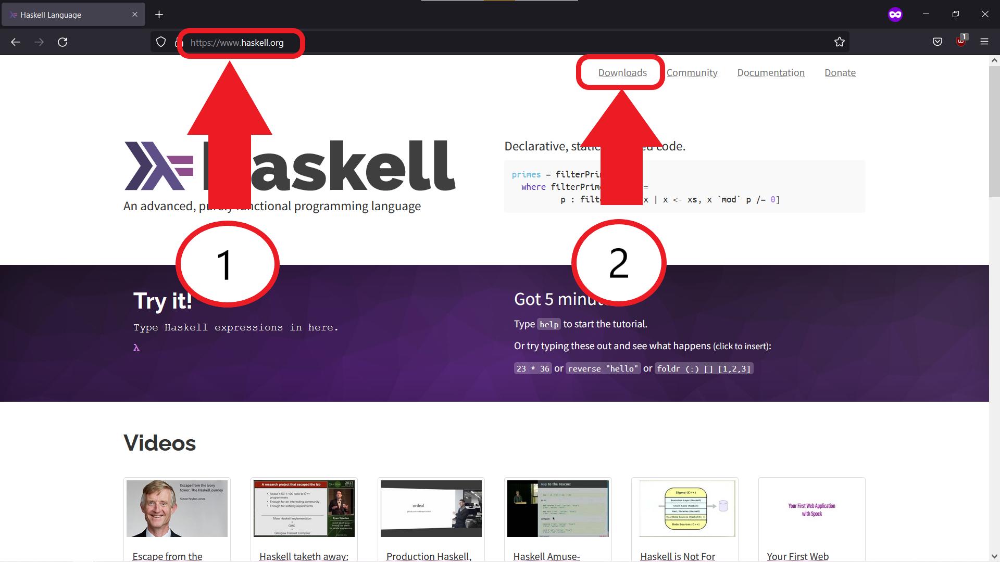

## Стъпка 3

Натиснете връзката `GHCup`:

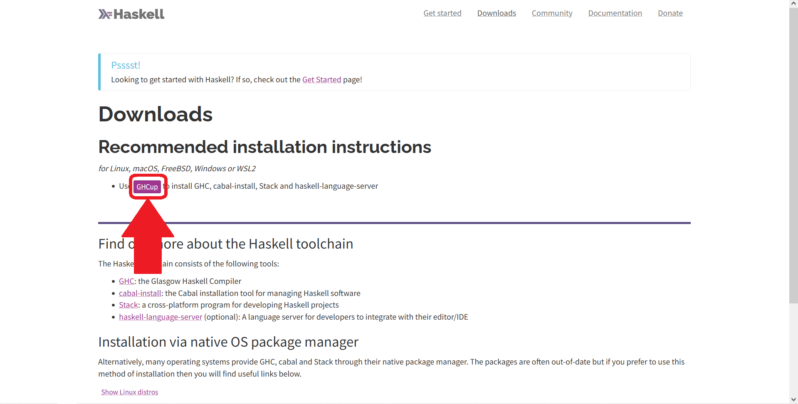

## Стъпка 4

Копирайте командата, която инсталира инструмента, с който се настройва Haskell:

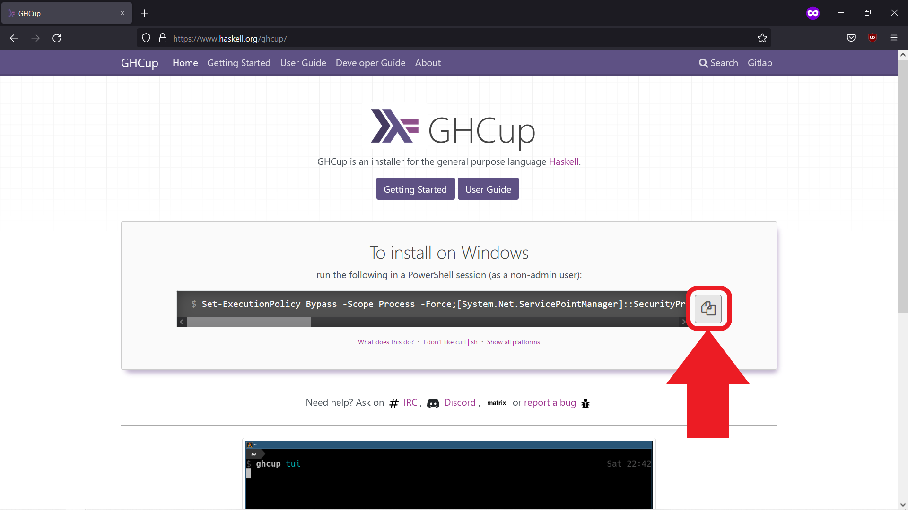

## Стъпка 5

Отворете PowerShell и поставете командата с `Ctrl + V`:

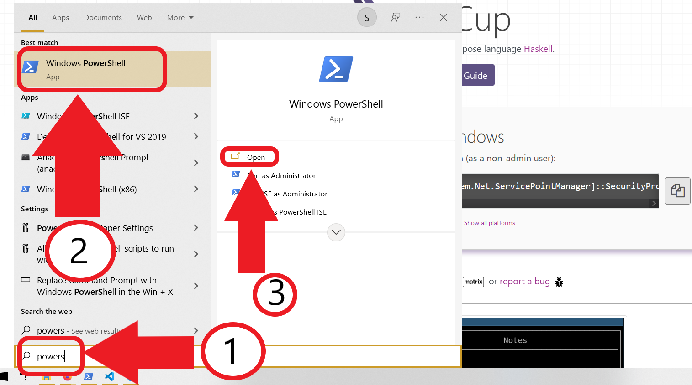

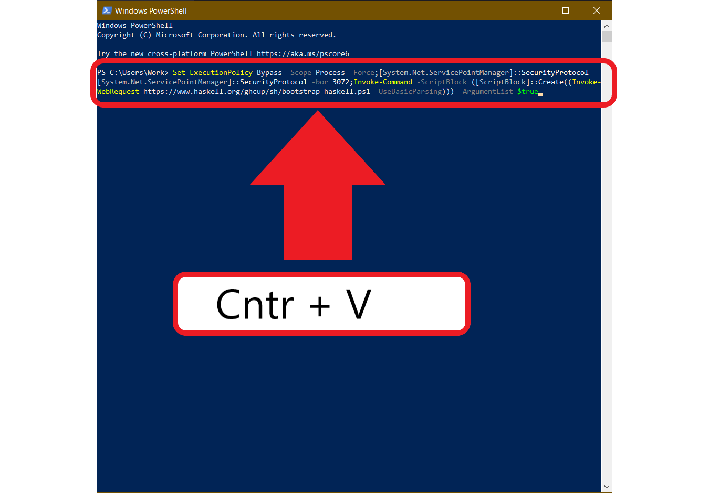

## Стъпка 6

Приемете отговорите по подразбиране при инсталирането на инструментите за Haskell:

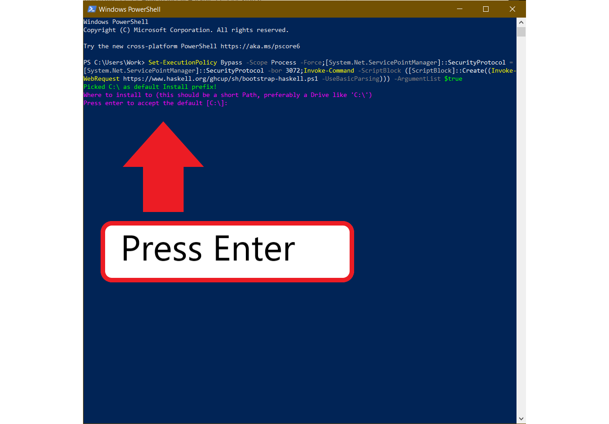

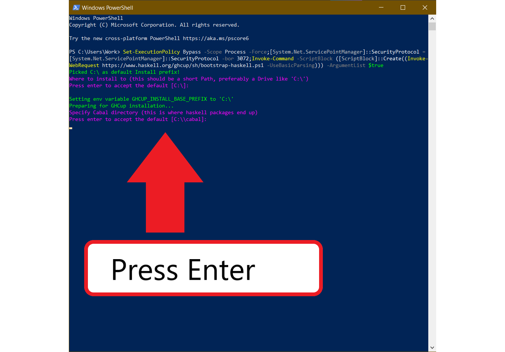

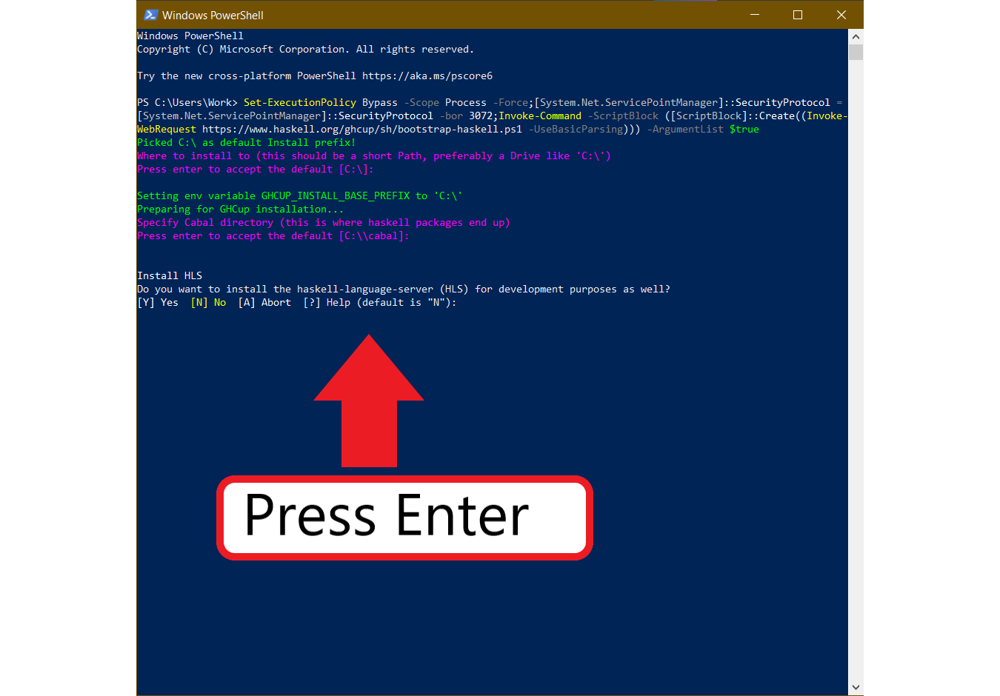

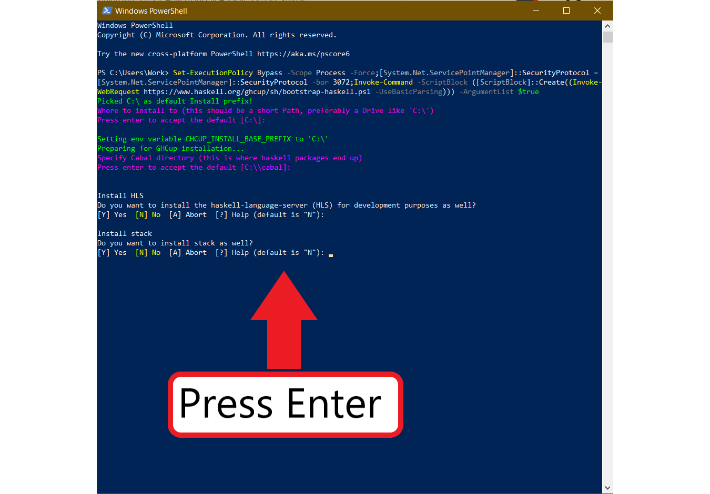

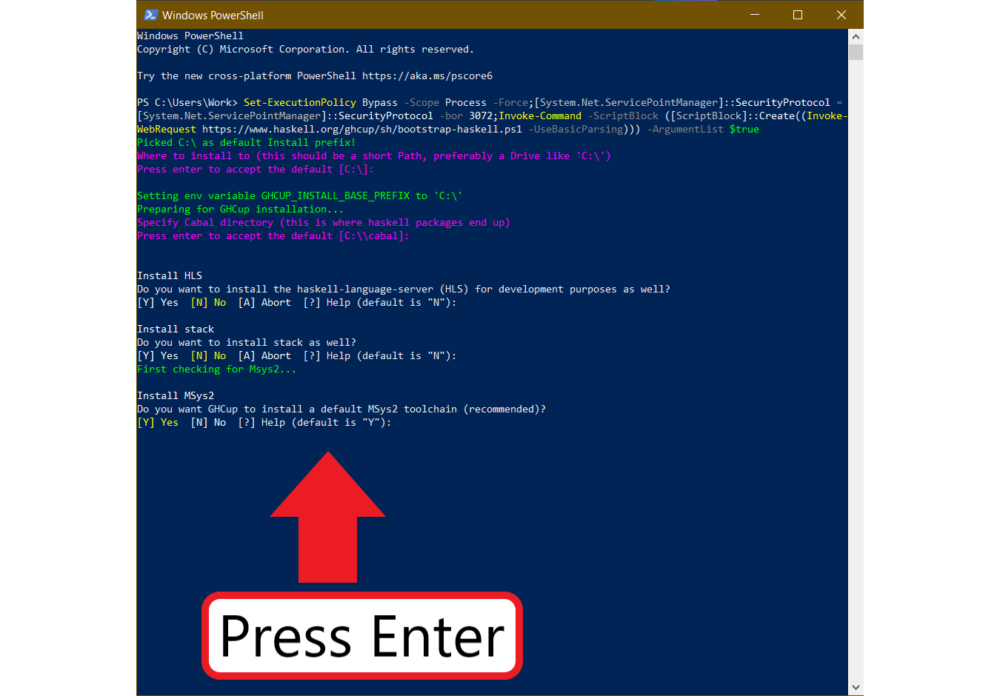

Това ще започне инсталацията. Тя отнема известно време - не затваряйте прозореца, докато не приключи.

Ако при първото изпълнение на командата получите грешка, поставете я и я изпълнете отново. Този път трябва да се появи въпрос дали искате да преинсталирате cabal - преинсталирайте го, като въведете `R`. Ако инсталацията пак е неуспешна, пишете ми имейл.

## Стъпка 7

След около 2-5 минути (в зависимост от скоростта на интернет връзката ви) трябва да се отвори още един прозорец:

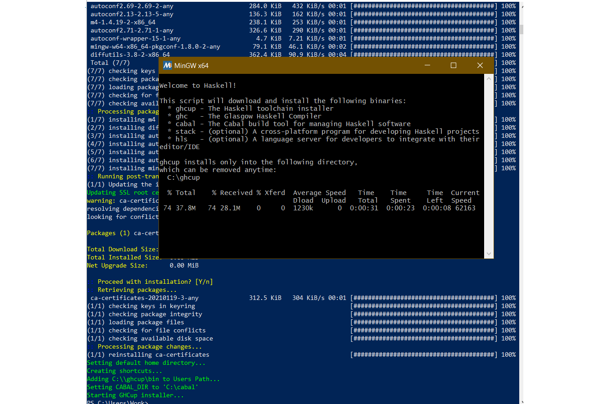

Това също е част от инсталацията и трябва да изчакате и тя да приключи. Ще отнеме около 10-20 минути (в зависимост от скоростта на интернет връзката ви).

Ако инсталацията е успешна, ще видите следния текст:

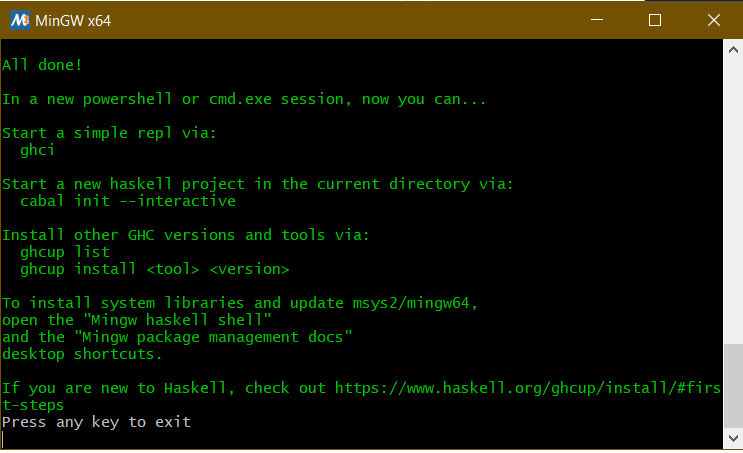

Можете да натиснете `Enter` и да затворите всички отворени прозорци.

## Стъпка 8

Нека проверим дали всичко работи. Отворете [официалния сайт на Visual Studio Code](https://code.visualstudio.com/) и изтеглете редактора (ако още не го имате).

След като го инсталирате, отворете го и инсталирайте следните разширения:
- Code Runner
- Haskell Syntax Highlighting

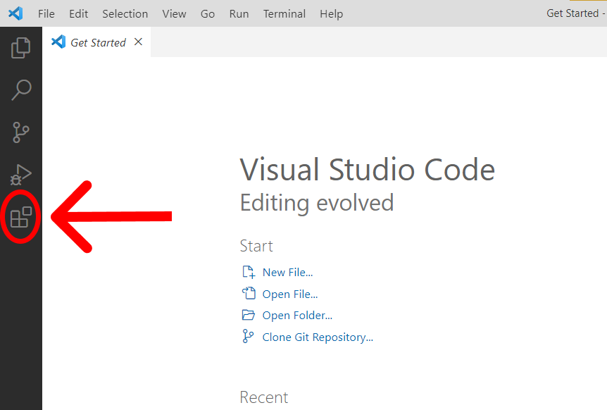

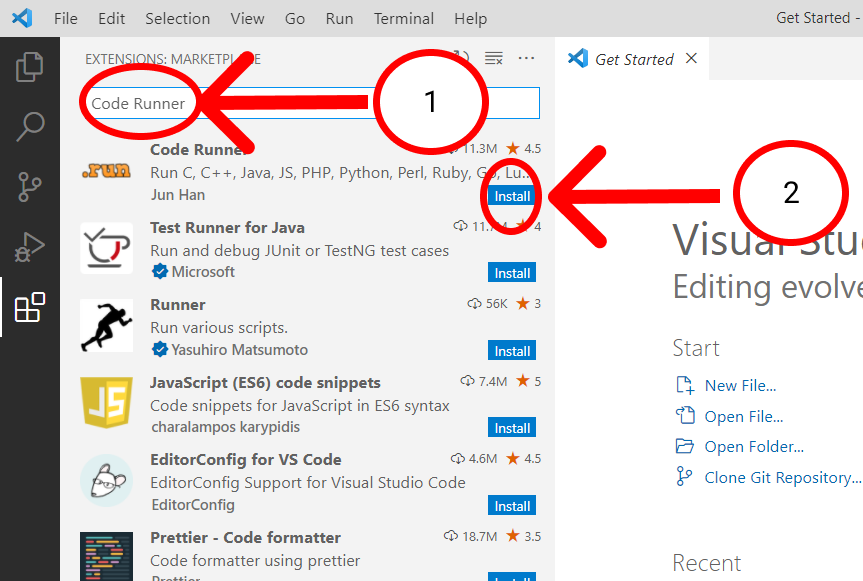

Направете същото и за *Haskell Syntax Highlighting*:

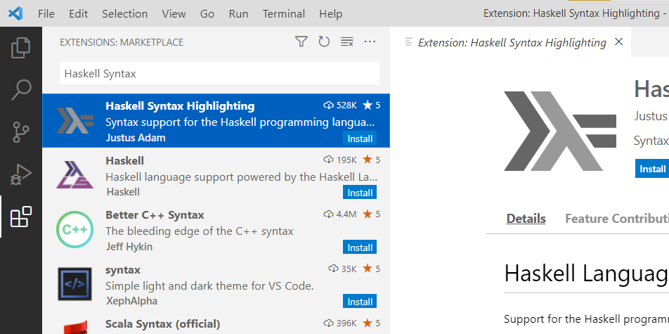

Сега създайте нов файл и го запазете като *test.hs*. Поставете в него следния код:

```haskell
main :: IO()
main = do
    print "Hello, world"
```

**Запазете файла** и натиснете бутона *Play* в горния десен ъгъл. Програмата трябва да изведе "Hello, world"!

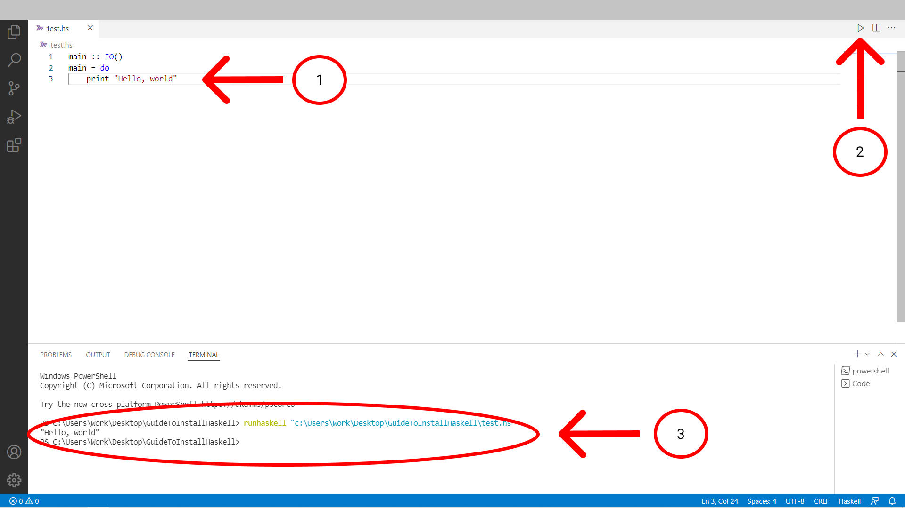

Поздравления! Успешно подготвихте компютъра си за програмиране на Haskell 🥳 !

**Автор на ръководството: Симеон Христов**
